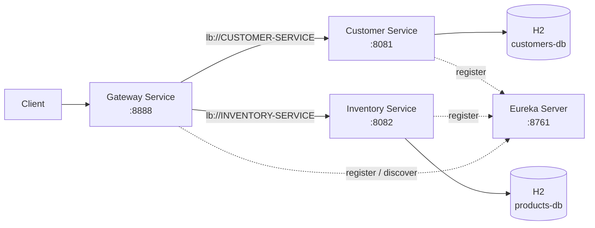

# E-Commerce Microservices — TP2

**Implémentation d'une architecture micro-services avec Spring Boot & Spring Cloud**

A Maven multi-module e-commerce backend built with Spring Boot and Spring Cloud. Services register with a Eureka discovery server, and an API gateway routes requests dynamically using the service IDs registered in Eureka — no per-service route configuration required.

---

## Architecture



| Module | Port | Role |
|---|---|---|
| `discovery-service` | **8761** | Eureka server — service registry |
| `customer-service` | **8081** | Customer domain REST API + H2 |
| `inventory-service` | **8082** | Product domain REST API + H2 |
| `gateway-service` | **8888** | Spring Cloud Gateway — dynamic routing & load balancing |

---

## Tech stack

- **Java 21**
- **Spring Boot 3.5.16**
- **Spring Cloud 2025.0.3**
- Spring Cloud Netflix Eureka (server + client)
- Spring Cloud Gateway (WebFlux, reactive)
- Spring Cloud LoadBalancer
- Spring Data REST + Spring Data JPA
- H2 in-memory database
- Lombok
- Maven (multi-module)

---

## Features

- Service discovery and registration with Eureka
- Dynamic gateway routing based on Eureka service IDs
- Client-side load balancing with `lb://` URIs
- HAL-based REST APIs generated by Spring Data REST
- Seed data loaded at startup
- Actuator health endpoints
- H2 web console for each domain service
- One-command start/stop PowerShell scripts

---

## Tutorial progression

| Part | What was built |
|---|---|
| 1 | `customer-service` — Spring Data REST + H2 |
| 2 | `inventory-service` — Spring Data REST + H2 |
| 3 | `gateway-service` — static routes to both services |
| 4 | `discovery-service` — Eureka registry + `lb://` load-balanced routes |
| 5 | Dynamic routing — gateway discovers services from Eureka automatically |

---

## Project structure

```
ecom-ms-app/
├── pom.xml                     # Parent POM (Java 21, Boot 3.5.16, Cloud 2025.0.3)
├── discovery-service/          # Eureka server (8761)
├── customer-service/           # Customers REST API + H2 (8081)
├── inventory-service/          # Products REST API + H2 (8082)
├── gateway-service/            # Spring Cloud Gateway (8888)
├── run-all.ps1                 # Start all four services
└── stop-all.ps1                # Stop all services
```

---

## Prerequisites

- JDK **21**
- Maven **3.9+**
- PowerShell (for the helper scripts, optional)

Verify your setup:

```bash
java -version
mvn -version
```

---

## Build

From the project root:

```bash
mvn clean package
```

To run the full build with tests:

```bash
mvn clean verify
```

> During tests, Eureka clients may log connection warnings because no Eureka server is running in the test context. The build still succeeds.

---

## Run

Always start the services in this order:

1. `discovery-service` (8761)
2. `customer-service` (8081)
3. `inventory-service` (8082)
4. `gateway-service` (8888)

### Option A — IntelliJ IDEA

Run these main classes, waiting for each to start:

```
DiscoveryServiceApplication
CustomerServiceApplication
InventoryServiceApplication
GatewayServiceApplication
```

### Option B — PowerShell script

After building the jars:

```powershell
.\run-all.ps1
```

If script execution is blocked:

```powershell
powershell -ExecutionPolicy Bypass -File .\run-all.ps1
```

The script starts discovery first, waits for it to be healthy, then launches the other three services in separate windows.

Stop everything with:

```powershell
.\stop-all.ps1
```

---

## API and URLs

### Eureka dashboard

```
http://localhost:8761
```

You should see `CUSTOMER-SERVICE`, `INVENTORY-SERVICE`, and `GATEWAY-SERVICE` registered as **UP**.

### Gateway — dynamic routes

The gateway exposes each Eureka service under its service ID:

| Request | Description |
|---|---|
| `http://localhost:8888/CUSTOMER-SERVICE/customers` | All customers |
| `http://localhost:8888/CUSTOMER-SERVICE/customers/1` | Single customer |
| `http://localhost:8888/INVENTORY-SERVICE/products` | All products |
| `http://localhost:8888/INVENTORY-SERVICE/products/1` | Single product |

Inspect the generated route table:

```
http://localhost:8888/actuator/gateway/routes
```

### Direct service access

| Service | URL |
|---|---|
| Customers | `http://localhost:8081/customers` |
| Products | `http://localhost:8082/products` |

### Actuator health

```
http://localhost:8761/actuator/health
http://localhost:8081/actuator/health
http://localhost:8082/actuator/health
http://localhost:8888/actuator/health
```

### H2 consoles

| Service | Console URL | JDBC URL | User | Password |
|---|---|---|---|---|
| Customer | `http://localhost:8081/h2-console` | `jdbc:h2:mem:customers-db` | `sa` | *(empty)* |
| Inventory | `http://localhost:8082/h2-console` | `jdbc:h2:mem:products-db` | `sa` | *(empty)* |

---

## Seed data

### Customers

| Name | Email |
|---|---|
| Mohamed | med@gmail.com |
| Imane | imane@gmail.com |
| Yassine | yassine@gmail.com |

### Products

| Name | Price | Quantity |
|---|---|---|
| Computer | 3200.0 | 12 |
| Printer | 1299.0 | 10 |
| Smart Phone | 5400.0 | 8 |

---

## Dynamic routing (Part 5)

Static routes were removed — `gateway-service/src/main/resources/application.yml` no longer exists. Instead, the gateway builds its route table from the services registered in Eureka.

`GatewayServiceApplication.java`:

```java
@Bean
DiscoveryClientRouteDefinitionLocator dynamicRoutes(
        ReactiveDiscoveryClient reactiveDiscoveryClient,
        DiscoveryLocatorProperties discoveryLocatorProperties) {
    return new DiscoveryClientRouteDefinitionLocator(reactiveDiscoveryClient, discoveryLocatorProperties);
}
```

For every registered service, the locator generates:

- **Predicate:** `Path=/<SERVICE-ID>/**`
- **Filter:** `RewritePath=/<SERVICE-ID>/?(?<remaining>.*) → /${remaining}`
- **URI:** `lb://<SERVICE-ID>`

So `GET /CUSTOMER-SERVICE/customers` is rewritten to `GET /customers` and forwarded to a healthy `CUSTOMER-SERVICE` instance through the load balancer.

Adding a new microservice requires **no gateway change**: as soon as it registers in Eureka as `MY-SERVICE`, it becomes available at:

```
http://localhost:8888/MY-SERVICE/**
```

> For third-party APIs that are not registered in Eureka, keep explicit static routes alongside the dynamic locator.

<details>
<summary>Declarative alternative</summary>

Instead of the bean, the same behaviour can be enabled with:

```properties
spring.cloud.gateway.server.webflux.discovery.locator.enabled=true
```

</details>

---

## Configuration highlights

### `discovery-service/src/main/resources/application.properties`

```properties
spring.application.name=discovery-service
server.port=8761

eureka.client.fetch-registry=false
eureka.client.register-with-eureka=false
```

### `gateway-service/src/main/resources/application.properties`

```properties
spring.application.name=gateway-service
server.port=8888

spring.cloud.discovery.enabled=true

management.endpoints.web.exposure.include=health,refresh,gateway
management.endpoint.gateway.access=read-only
```

> On Spring Boot 3.5, use `management.endpoint.gateway.access=read-only`; the older `management.endpoint.gateway.enabled` property is no longer supported.

---

## Troubleshooting

| Problem | Solution |
|---|---|
| Gateway returns **503** right after startup | Wait ~30 seconds for the Eureka registry refresh |
| Gateway returns **404** on `/customers` | Static routes are removed by design — use `/CUSTOMER-SERVICE/customers` |
| `Port 8888 was already in use` | Stop the previous gateway instance: `Get-NetTCPConnection -LocalPort 8888 -State Listen \| ForEach-Object { Stop-Process -Id $_.OwningProcess -Force }` |
| Services not visible in Eureka | Make sure `discovery-service` starts first, then wait ~30 seconds |
| Data disappears after restart | H2 is in-memory; seed data is recreated on every start |
| `mvn clean` fails on Windows | A running service is locking a jar — stop it first |

---

## Author

**Nassime Khatib** — [@Nassimek04](https://github.com/Nassimek04)

TP2 — Implémentation d'une architecture micro-services.
